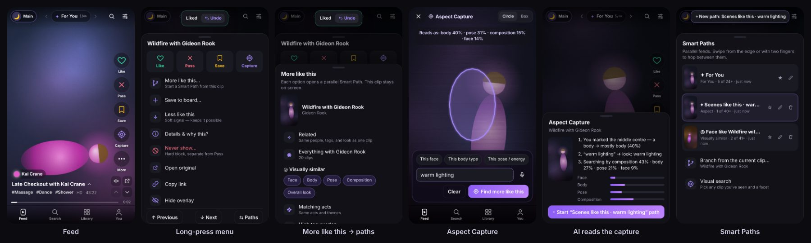
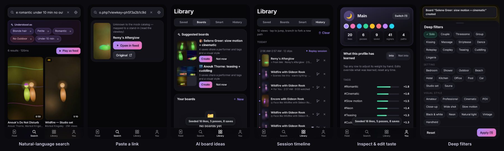

# PH Discovery — vertical swipe discovery PWA (mock-data prototype)

A mobile-first PWA (tuned for iPhone/iPad) that turns discovery into a TikTok-style
vertical feed: you teach it your taste with swipes, it builds parallel **Smart Paths**,
and you can circle part of a frame to spin off a new path about *that*.

The whole experience runs on a local mock data layer: a deterministic catalogue of
~900 fictional clips, procedural visuals standing in for video, and a rules-based mock
"AI". The same interfaces are meant to take a live source and real models later.




## Run it

```bash
cd discovery
npm install
npm run dev            # http://localhost:5173 (also on your LAN via --host)
npm test               # 56 unit tests (engine, AI, data layer, gestures, store/privacy, regressions)
npm run build          # typecheck + production build + service worker
npx vite preview --port 4173 &
npm run e2e            # 29 Playwright checks at iPhone 14 size, real gestures
```

**On an iPhone:** run `npm run dev`, open the LAN address in Safari, then Share → *Add to
Home Screen*. As a standalone PWA there is no browser back-swipe fighting the left-edge
gesture. In a plain Safari tab (and on Android with gesture navigation), the OS owns the
outermost edge. Use two fingers for path switching there. If the system back gesture does
fire, the app treats it as in-app back: it closes the top sheet, capture, or tab instead of
leaving.

## Gestures

| Gesture | Discovery scheme (default) | Classic scheme (TikTok-style) | Tap fallback |
|---|---|---|---|
| Swipe right / left | Like / Pass (+ haptic, learning signal) | same | ♥ / ✕ on the rail |
| Swipe up | Save (+ haptic) | Next clip | 🔖 on the rail |
| Swipe down | **Aspect Capture** (pause + annotate) | Previous clip | ⌖ on the rail |
| Edge strip or two fingers ↑↓ | Next / previous clip | same | ▲ ▼ mini buttons, wheel, J/K |
| Edge strip or two fingers ←→ | Switch Smart Path | same | ‹ › in the path bar, `[` `]` |
| Long-press | Full menu | same | ⋯ on the rail |
| Double-tap | Like without moving on | same | — |
| Tap | Play / pause | same | Space |

First run shows a gesture guide, and contextual tips appear later. *You → Playback &
gestures* switches scheme, handedness, "move on after like/save", immersive overlay, and
data saver (preload 1 instead of 2).

Haptics use the Vibration API on Android. iOS has no Vibration API, so on iOS 18+ the app
toggles a hidden `<input type="checkbox" switch>` inside the gesture handler, which
produces the system tick.

## What's in it

- **Search:** keyword (titles, performers, tags, studios, series), natural language
  ("blonde petite romantic under 10 min, no outdoor", "looks like Mira Vale", "warm dark
  grainy"), paste-a-link, and visual search seeded from any clip you've seen. The AI's
  interpretation shows as **removable chips**. Results open as a feed or seed a path.
  Recent searches and profile-based suggested queries appear when the box is empty.
- **Smart Paths:** For You (multi-interest AI blend), Related, Same performer, Visually
  similar (face / body / pose / composition / overall), Matching acts, Tag overlap, Same
  studio, Series (in order), Contrast (deliberately outside your taste), Aspect (from a
  capture), AI cluster, Search, and Collection (any board, smart collection, or history
  slice). Paths are infinite, buffered queues, re-ranked in near real time after each
  explicit signal.
- **Learning:** explicit signals (like, pass, save, capture, more/less) plus implicit ones
  (watch-through, replays, quick skips). Each taste profile is a full silo: signals,
  paths, library, history, filters, and blocks. The model is a **pure fold over the signal
  log** with a 45-day half-life, so deleting a signal or resetting a profile removes its
  effect exactly. You can inspect and edit every learned weight, hard-block anything
  (separate from Pass), and get proactive AI path ideas once there's enough signal.
- **Organization:** saves carry auto-metadata (source path, clip position, time) plus your
  note and custom tags. There are boards, AI-suggested boards (clusters of your saves),
  and smart collections by performer, act, studio, custom tag, liked, replayed,
  watched-through, and saved this week. Every collection replays as a feed. History is a
  session timeline with **jump** (back to that spot in its path) and **branch** (start a
  new path from that clip).
- **Video & overlay:** full-screen vertical players, muted autoplay, preload next 2,
  fallback chain **embed → direct source → open original**, a minimal overlay with an
  expandable details sheet (including "why you're seeing this"), and open-original on
  every clip.
- **Deep filters:** performer include/exclude and attributes, tag logic (must have / any of
  / exclude), soft tag weights, studios, style, quality, length, year, a
  familiar↔discovery slider, and saved presets. Filters apply per path or profile-wide.
- **Privacy:** everything stays in IndexedDB on the device. **Incognito** pauses all disk
  writes (signals, history, searches, *and* path progress), and turning it off rewinds to
  the pre-incognito state. Also included: pause learning, discreet (blurred) thumbnails, PIN
  app lock (armed before first paint), export/import JSON, per-profile reset, and erase
  everything. There's an 18+ gate on first run and a query safety gate (below).

## Architecture

```
src/
  data/           ← the contract
    types.ts        DataSource interface + every shared type
    api.ts          active source + summary/detail caches (swap the source here)
    links.ts        paste-link parsing (viewkey / /video/<id> / fallback)
    safety.ts       query gate: minors & non-consent terms are refused outright
    mock/           deterministic catalogue + MockDataSource (latency/error/embed-fail knobs)
  ai/             ← AI hooks (mock provider today)
    index.ts        AIProvider interface: interpretQuery, interpretAspect, embedFrame
    interpret.ts    NL → tags/performers/attributes/durations/visual target + chips
    aspect.ts       drawn region + words → facet weights + focused vector
    cluster.ts      k-means++ (cosine)
    suggest.ts      path ideas, board ideas, suggested queries, cluster naming
  engine/         ← pure, unit-tested
    learning.ts     signal values, implicit-signal rules, fold → TasteModel
    ranking.ts      relevance × taste × filters, blocks, MMR diversity, reasons
    paths.ts        path kinds → candidate queries → ranked, buffered queues
    filters.ts      deep filters: hard constraints + soft weights, merge rules
  state/          ← zustand stores
    store.ts        persisted (IndexedDB) app state, per-profile silos
    feed.ts         feed controller: buffering, nav, view tracking, judge/save/block
  gestures/       ← classify.ts (pure) + useStageGestures.ts (pointer engine) + haptics
  player/         ← renderer.ts (procedural clips) + ClipPlayer.tsx (fallback chain)
  views/, components/
```

### The data-layer contract

`src/data/types.ts` defines `DataSource`:

```ts
search(query, filters?, page?)  → SearchResults   // keyword + structured + visual target
getVideo(id)                    → VideoDetail     // metadata + performers + playback chain
getVideos(ids)                  → VideoSummary[]
getSimilar(seed, page?)         → SearchResults   // seed: video+facets | embedding(+mask) | tags
explore(page?)                  → SearchResults   // broad candidate pool for blends
resolveUrl(url)                 → ResolvedLink | null
taxonomy()                      → tags, performers, studios, series
```

The source returns *candidates with relevance*; the client re-ranks with the local taste
profile. That split keeps learning on the device.

**Wiring a live source later:** implement `DataSource`, call `setDataSource()` in
`src/data/api.ts`, and make sure every `VideoSummary` carries an `embedding` (32 dims =
face·body·pose·composition × 8, or change `FACET_DIM`) and an `originalUrl`. For real
media, return `{kind:'embed'|'source', url}` playback options; `ClipPlayer` already
handles iframe embeds and `<video>` sources and falls through to "open original".

**Wiring real AI:** implement `AIProvider` (`src/ai/index.ts`). `interpretQuery` →
LLM-structured output in the `Interpretation` shape; `embedFrame` → a CLIP-style image
encoder over a captured frame or region; keep `interpretAspect`'s `steps` so the UI can
show its reasoning.

### Why the mock "AI" gives believable results

Embeddings aren't random. A clip's face/body facets come from its performers, pose from
its acts, and composition from studio, setting, and style tags. The procedural renderer
draws *those numbers*: glow hue from the face vector, figure shape from the body vector,
arrangement from pose, light and grain from composition. So "visually similar: face"
really does return clips that look alike. Circling the head in Aspect Capture weights the
face facet, and circling the background weights composition, because the hit test
reads the renderer's own geometry.

## Mock data layer console

*You → Mock data layer* sets latency, jitter, error rate (up to 100%), and the embed
failure rate, so you can watch skeletons, retry states, and the playback fallback chain.
**Seed a demo taste** fast-forwards ~20 likes, 5 passes, and 8 saves so clusters, AI
path ideas, and board suggestions appear immediately.

## Known limits / next steps

- Visuals are procedural stand-ins, and the mock clips are silent. Real playback paths
  exist but are untested against a live host.
- The mock AI is rules plus synthetic embeddings. Swap in real models via `AIProvider`.
- Visual search is deliberately seeded only from catalogue clips/frames, **never from an
  uploaded photo of a person**. See the legal notes for why that line matters.
- No sync. Everything is local by design (see privacy note below before adding any).

## Before connecting live data — legal flags (verify before relying)

These are notes for counsel, not legal conclusions:

1. **Age verification.** *Free Speech Coalition v. Paxton* (U.S. June 27, 2025) upheld
   Texas's HB 1181 under intermediate scrutiny, and roughly two dozen states now have
   similar laws. A click-through 18+ gate like this prototype's is not verification.
   Whether an embed/aggregator app is itself the "commercial entity" that "publishes or
   distributes" the material is the threshold question, and it will turn on how the live
   integration is built.
2. **Viewing history is sensitive data.** NJ's Data Privacy Act (effective Jan. 15, 2025)
   treats data revealing "sex life or sexual orientation" as *sensitive*, which means
   opt-in consent once a controller meets the applicability thresholds. Adult-content
   preferences plausibly qualify. Local-first storage sidesteps this only while nothing
   leaves the device. Any analytics pixel or SDK also invites **VPPA** (18 U.S.C. § 2710)
   claims, the current class-action favourite for video sites.
3. **Biometrics.** Face-similarity embeddings of real performers may be "biometric
   identifiers" under Illinois BIPA (private right of action, statutory damages), Texas
   CUBI, and Washington's law. Keeping visual search catalogue-seeded limits the
   "find this person" misuse path, but computing face embeddings at all is the exposure.
4. **NCII.** N.J.S.A. 2C:14-9 and the federal TAKE IT DOWN Act (2025; 48-hour removal for
   covered platforms) matter if the app ever hosts or lets users upload anything. The
   built-in query gate already refuses non-consent and covert-capture searches.
5. **Source terms & marks.** Use the source's official embed or partner API rather than
   scraping. "PH" plus any orange-on-black trade dress could draw a Lanham Act letter.
   The prototype deliberately uses neutral violet branding.
