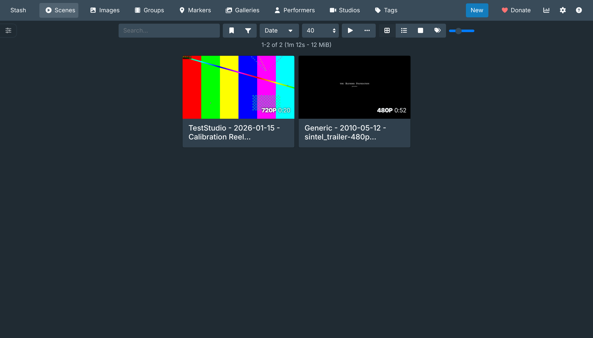

# MediaVault: a private, offline media library on Stash

Think of it as a private "tube site" that runs on your own machine and never phones home. The library software is [Stash](https://github.com/stashapp/stash). This kit adds verified installation, a sensible folder layout, a download-to-library pipeline, and a command-line remote for the jobs you'd otherwise click through.

Tested end to end on **Stash v0.32.0** (released 2026-11-02) with yt-dlp 2026.10.26.



## Ground rules (read once)

- **Only ingest what you have a right to keep:** your own purchases, creator-permitted downloads, and freely licensed material. Downloading copyrighted work without permission is infringement. Getting around paywalls or DRM is a separate violation (17 U.S.C. § 1201). Most sites' terms of service forbid scraping. None of this is legal advice.
- **Never re-upload or share** anything from the vault.
- **Privacy is a setting, not an assumption.** Stash listens on `0.0.0.0` (your whole network) by default. This kit pins it to `127.0.0.1`, so only this machine can reach it. Open it to the LAN only after you set a password.

## Quick start

```bash
./install.sh                          # Linux/macOS → ~/MediaVault
```
```bash
./install.sh --root /Volumes/Vault    # better: install onto an encrypted volume
```
```powershell
powershell -ExecutionPolicy Bypass -File .\install.ps1 -Root V:\MediaVault   # Windows
```
```bash
MEDIAVAULT_ROOT=/srv/vault docker compose up -d   # Docker / NAS
```

Each installer downloads the official release binary and **checks its SHA1 against the release's own `CHECKSUMS_SHA1` file** (it aborts on a mismatch). It then writes a localhost-only `config.yml` and creates this layout:

```
MediaVault/
├── bin/stash            the server (one static binary)
├── start-stash.sh       launcher
├── staging/             downloads land here; partial files never reach the library
├── library/
│   ├── videos/<Studio>/ filed automatically by ingest.py
│   ├── images/<Set>/    each folder becomes a gallery
│   └── vr/
└── stash/               database, previews, covers, scrapers, plugins, backups
```

Start it with `~/MediaVault/start-stash.sh`, then open **http://127.0.0.1:9999**.

### First-run checklist (in the web UI, about 5 minutes)

1. **Settings › Security**: set a username and password, then **Generate API key**. Copy `.env.example` to `.env` and paste the key into it.
2. **Settings › Metadata Providers › Stash-box endpoints**: add the databases you want. You'll need a free account and an API key for each.
   - StashDB: `https://stashdb.org/graphql`
   - ThePornDB: `https://theporndb.net/graphql`
   - FansDB: `https://fansdb.cc/graphql`
3. **Settings › Metadata Providers › Available Scrapers**: install scrapers from the community index for the sites you buy from.
4. **Settings › Library**: add any extra drives or NAS paths.

## Everyday use

### Ingest: one command from URL to tagged scene

```bash
python3 ingest.py "https://example.com/video/123"
```
```bash
python3 ingest.py --cookies cookies.txt "https://store.example.com/my-purchases/456"
```
```bash
python3 ingest.py --batch urls.txt --limit-rate 5M
```
```bash
python3 ingest.py --images "https://example.com/gallery/789"
```
```bash
python3 ingest.py --file-only     # you dropped files into staging/ by hand
```

What each run does:

1. Downloads with **yt-dlp** into `staging/.tmp`, using the best quality up to 4K (`--max-height` changes the cap). It also embeds metadata, the thumbnail, and chapters.
2. Names each file `Studio - YYYY-MM-DD - Title [id].mp4`, the shape Stash's filename parser and scrapers expect.
3. Records the video ID in a **download archive**, so the same video is never downloaded twice. (Tested: the second run of the same URL was skipped.)
4. Moves only *finished* files into `library/videos/<Studio>/`. Files with a `.part` or `.ytdl` partner stay in staging.
5. Tells Stash to **scan** (covers, previews, scrubber sprites, pHash), then **identify** (fingerprint match against StashDB/TPDB), then **autotag**.

`aria2c` is used automatically if it's installed. It speeds up large files with 8 parallel connections. Install the tools with `pipx install yt-dlp gallery-dl`.

**Cookies:** for content behind your own login, export a `cookies.txt` with a browser extension. Better still, pass yt-dlp's `--cookies-from-browser firefox` yourself. Keep cookie files out of the repo (`.gitignore` already blocks `*cookies*.txt`). Never paste them into online "downloader" sites.

### stashctl: a remote control for Stash

| Command | What it does |
|---|---|
| `stashctl.py stats` | Scene, image, and performer counts, plus total size and hours |
| `stashctl.py scan [PATH]` | Scan, then generate covers, previews, sprites, and pHashes |
| `stashctl.py identify [PATH] [--scraper ID]` | Match scenes by fingerprint against every stash-box you configured, in priority order, and create missing performers, studios, and tags |
| `stashctl.py autotag [PATH]` | Tag from filenames using the performers, studios, and tags you already have |
| `stashctl.py generate` | Fill in any missing previews, sprites, or pHashes |
| `stashctl.py dupes [--distance 8]` | List duplicate groups by perceptual hash |
| `stashctl.py clean [--apply]` | Remove database entries for deleted files (dry run unless `--apply`) |
| `stashctl.py backup` | Write a timestamped SQLite backup to `stash/backups/` |

## Things learned while testing (the needles in the haystack)

- **pHash catches re-encodes, not just copies.** A 720p video and a 640×360 re-encode of it, with different bytes and different sizes, came back as one duplicate group even at `--distance 0`. Run `dupes` before buying "the HD version" of something you already own.
- **Identical files merge into a single record, permanently.** Stash treats byte-identical files anywhere in the library as one image or scene with several file paths. That's good for dedup. The catch: if you later overwrite one of those files with different content, Stash does *not* split it back out. Fix it by deleting the record in the UI and rescanning.
- **The default bind address is your whole LAN.** Stash ships with `host: 0.0.0.0`. Everything in this kit pins `127.0.0.1`, and the Docker file binds the port to `127.0.0.1:9999`.
- **`--restrict-filenames` is a trap.** It turns spaces into underscores and strips non-ASCII characters, which breaks scraper matching for Japanese and other non-English titles. The kit uses `--windows-filenames` instead, so names stay legal on NTFS and exFAT drives without the mangling.
- **Direct-file URLs have no uploader**, so they file under `library/videos/Generic/`. Rename the folder, or let identify fix the studio.

## On your phone (with Tailscale)

Stash treats Tailscale addresses (`100.64.0.0/10`) as local network traffic (`internal/api/request_ip.go`), so no Stash-side changes are needed beyond a password.

**A. No commands** (Stash installed with the normal app or `stash-win.exe`, which listens on all networks by default):
1. Set a password: **Settings › Security**. Required, because your home Wi-Fi can see Stash too.
2. On the phone, turn on Tailscale and open `http://<computer-name>:9999` (or `http://100.x.y.z:9999`). The name and address are shown in the Tailscale menu on the computer.
3. Add it to the Home Screen (iPhone: Share › Add to Home Screen. Android: ⋮ › Add to Home screen).

**B. Private HTTPS address** (also works with this kit's localhost-only config, and hides Stash from home Wi-Fi):
1. In the Tailscale admin console › DNS, turn on **MagicDNS** and **HTTPS Certificates**.
2. Run this once on the computer. It keeps working after restarts.
   - Windows (PowerShell): `tailscale serve --bg 9999`
   - Mac (Terminal): `/Applications/Tailscale.app/Contents/MacOS/Tailscale serve --bg 9999`
3. Open the `https://<computer>.<tailnet>.ts.net` address it prints on your phone.

The computer has to stay on and awake, with Stash running. Turn off sleep while it's plugged in, and add Stash to your login items or startup folder. If playback stutters on cellular, lower **Settings › System › Transcoding › Maximum streaming transcode size** to 720p.

## Hardening options

- **Encrypt at rest:** put the whole `MediaVault/` folder on a VeraCrypt container, a LUKS volume, FileVault, or BitLocker. The database, thumbnails, and previews reveal as much as the videos do, so encrypting only the media isn't enough.
- **Back up the metadata, not just the media:** `stashctl.py backup` on a schedule (cron or Task Scheduler), plus a copy of `stash/config.yml`. Your tags, ratings, and markers are the hours of work. The files themselves you can re-download.
- **LAN or phone access:** set a password first, then change `host:` to `0.0.0.0`. For access from outside the house, use Tailscale or WireGuard. Never forward the port on your router.
- **Automated acquisition:** Whisparr plus Prowlarr can feed `staging/`, and `ingest.py --file-only` on a timer can file and scan whatever arrives.

## Files

| File | Purpose |
|---|---|
| `install.sh` / `install.ps1` | Verified install for Linux/macOS/FreeBSD/ARM and for Windows |
| `docker-compose.yml` | Container install, pinned to `v0.32.0`, localhost-bound |
| `ingest.py` | yt-dlp/gallery-dl → staging → library → scan → identify → autotag |
| `stashctl.py` | Command-line client for Stash's GraphQL API (Python standard library only) |
| `.env.example` | `STASH_URL`, `STASH_API_KEY`, `MEDIAVAULT_ROOT` |
