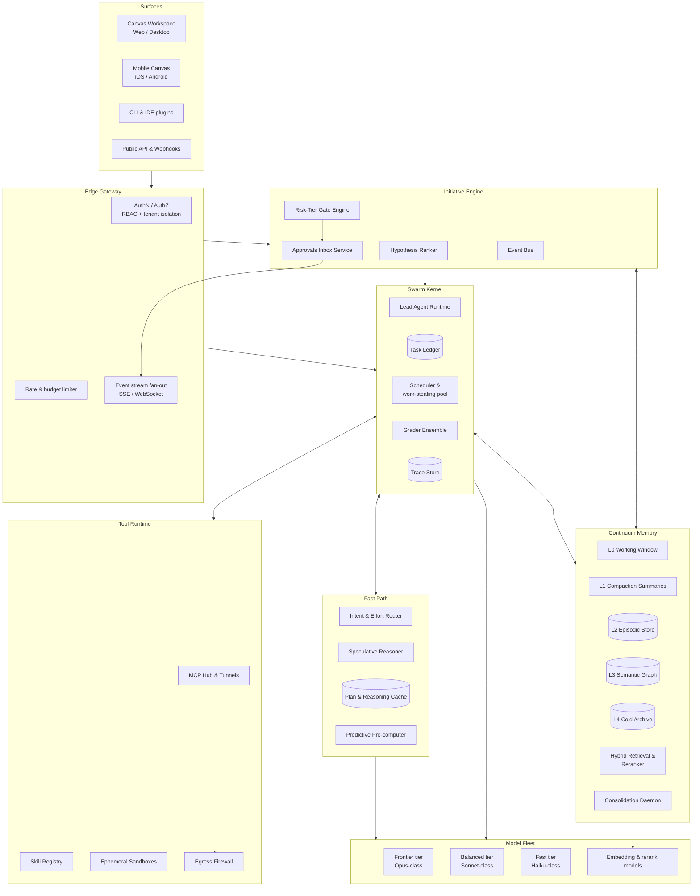
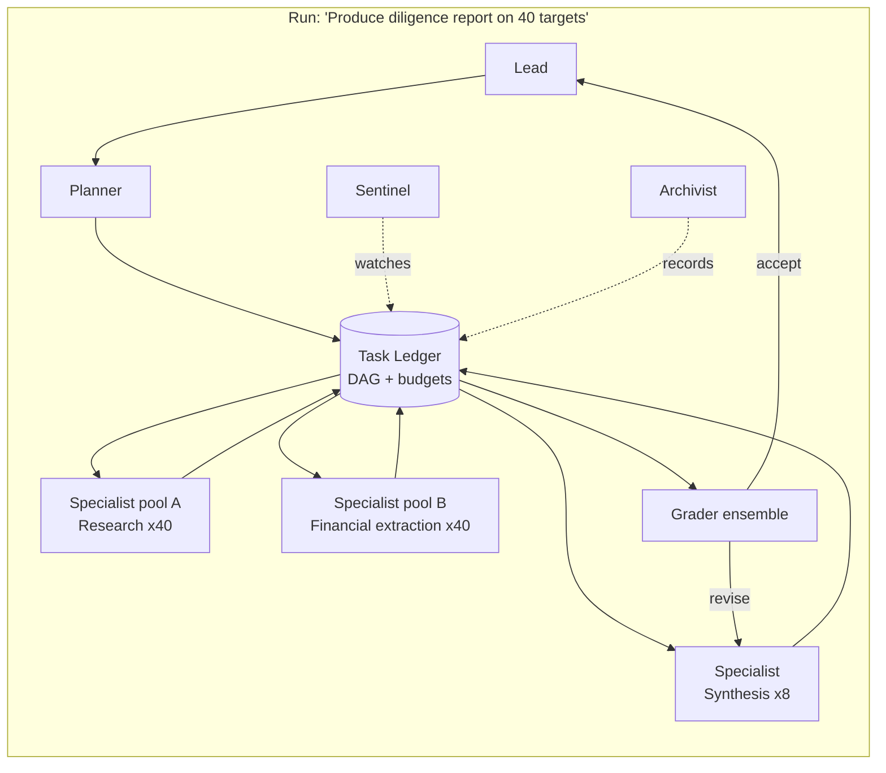
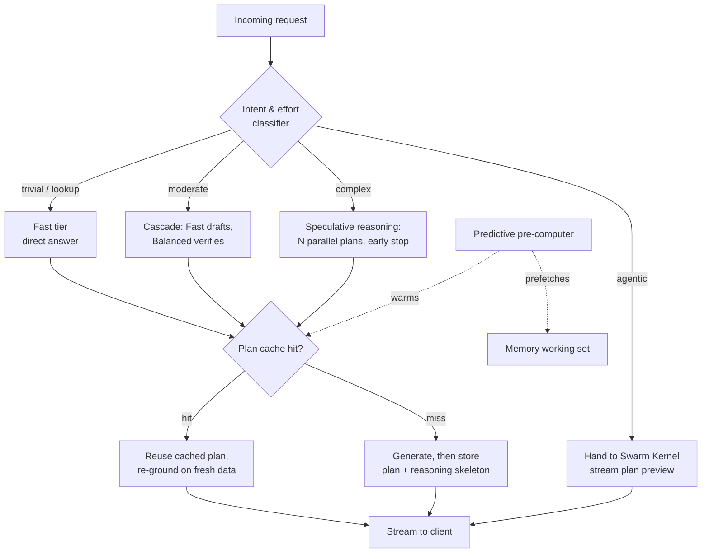
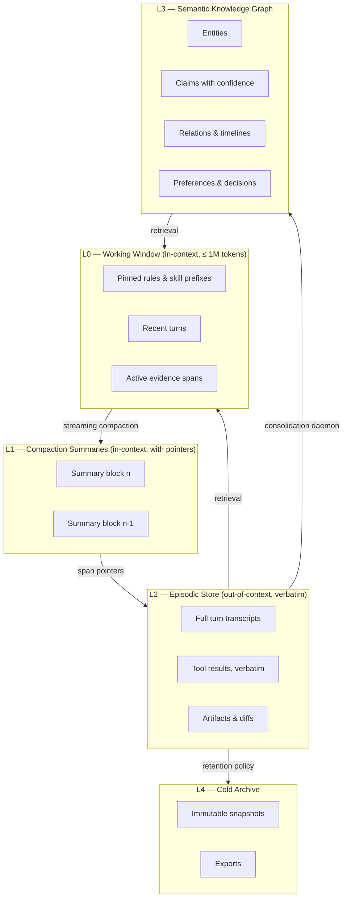
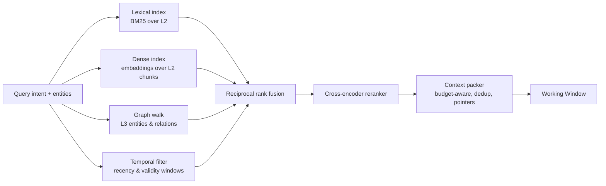
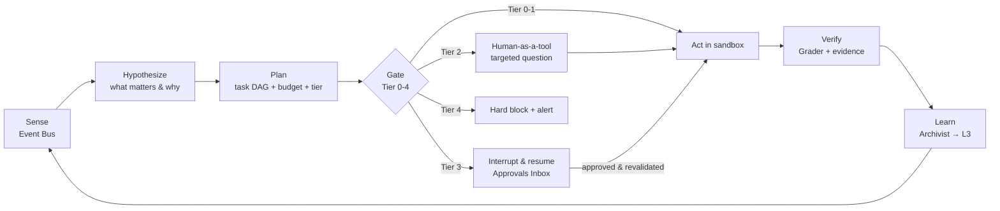
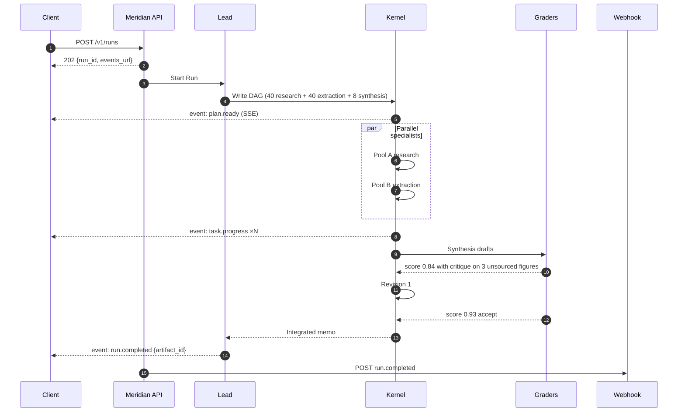
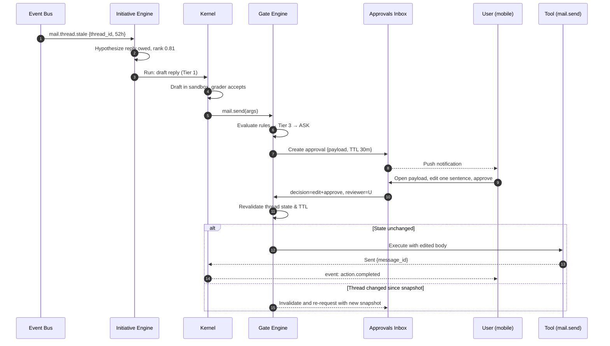
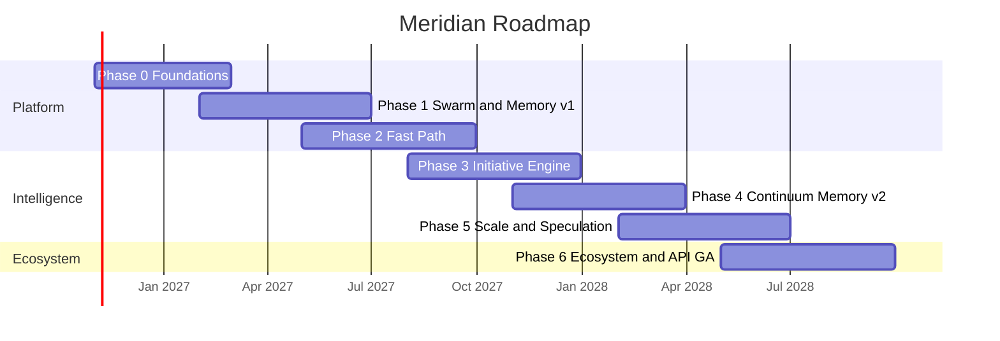

# Meridian — Next-Generation AI Assistant
## Product Architecture Specification

| Field | Value |
|---|---|
| Document | Meridian Product Architecture Specification (PAS-001) |
| Version | 1.1 — Revised after architecture review (see §0) |
| Date | October 31, 2026 |
| Status | Proposed — v1.1 resolves the review findings; reference implementation in `meridian/` |
| Audience | Product, platform engineering, model infrastructure, trust & safety, design |
| Codename | Meridian (working title) |

---

## 0. Revision Notes (v1.0 → v1.1)

The architecture review of v1.0 found the document internally consistent on budgets, roadmap and citations, and structurally weak in one place: the risk-tier system that the safety story leans on. v1.1 makes the following changes. Each is marked **[v1.1]** where it lands in the body.

| # | Finding in v1.0 | Resolution in v1.1 |
|---|---|---|
| 1 | Tier 2 was defined as "ambiguous / low confidence", a state of the agent's mind, while Tiers 0, 1, 3, 4 were action classes defined by blast radius and reversibility. An action could be Tier 2 and Tier 3 at once with no rule for which gate wins. | Action classes carry a Tier of 0, 1, 3 or 4 only. Confidence and topic triggers are an orthogonal **oversight modifier** that can raise a Tier 0/1 action to a Tier 2 question and can never lower anything or touch Tier 3/4. Numbering 0–4 is kept for UI and telemetry stability. (§8.4) |
| 2 | Telemetry flagged gates approved > 95% of the time "for demotion to Tier 1". Reversibility is a property of the action, not of how often reviewers say yes. Phase 3's exit criterion turned this into a target that rewards rejecting good actions. | Telemetry flags **payload or batching redesign** (digest with one consolidated approval, richer verification payload). Tiers never change on telemetry. Phase 3 exit criterion rewritten. (§3, §8.7, §13, §14) |
| 3 | Writes to L2/L3 memory were Tier 1 "locally reversible", but L2 is append-only and L3 is shared across workspaces. A poisoned tool result could plant a false fact autonomously; §11 quarantined *instructions* but not *facts*. | Tier 1 only **stages** a memory candidate. Promotion into L2/L3 is a separate deterministic step: every pointer must resolve and every quoted span must match. Failures land in a **fact quarantine** surfaced to the user. (§7.5, §8.4, §11) |
| 4 | Retrieval ran before intent classification, but the packer's token budget was set from the effort level that classification produces. | Two-phase routing: (A) fixed-budget prefetch of the pinned working set, (B) classify → effort → budget → budgeted retrieval. (§4.3, §6.2, §7.4) |
| 5 | Fast-tier answers streamed at < 400 ms TTFT and also had to pass an evidence check before acceptance. A token cannot be verified before it is streamed. | Fast-tier output is a **provisional** stream. The deterministic evidence check runs on the completed text and can retract or escalate. TTFT targets apply to the provisional stream. (§6.2, §6.4) |
| 6 | Phase 0 shipped the Gate Engine (which can say "ask") but the Approvals Inbox (the thing "ask" resolves into) arrived in Phase 1. | A minimal Inbox (create, decide, TTL, revalidate) moves into Phase 0. (§13) |
| 7 | §8.6 rested the approval-payload design on "research summarized in the HITL design framework this spec adopts" with no citation, in a document whose second principle is that evidence travels with every claim. | Restated as an explicit, labelled **design assumption** with an open question to source it before approval. (§8.6, §15) |
| 8 | Headline table promised 10,000 *agents* per run; §5.5 and §12 said 10,000 *tasks*. Lead context was called O(log n); with a ~50-summary fan-in it is bounded by a constant. Task status values were used but never enumerated. The Week 27 reference was listed but never cited. | Corrected and enumerated. (§1, §1 "Why now", §5.4, §5.5) |
| 9 | No litigation hold. Retention expiry and the Forgetting job ran on their own schedules with nothing to freeze them. No delegation of approval authority or approver audit trail. | Litigation hold on workspace or run freezes L2/L3/trace against retention and Forgetting. Scoped, expiring, revocable approval delegation with an audit trail. Both are Phase 0 scope. (§7.5, §8.6, §11, §12, §13) |

A reference implementation of every contract in this document, with tests, lives in `meridian/` beside this file.

---

## 1. Executive Summary

Meridian is a next-generation AI assistant designed to take the strongest capabilities Anthropic has shipped in Claude over the past twelve months and push each of them an order of magnitude further. The four pillars of the design are:

1. **Swarm Kernel** — multi-agent orchestration that scales from a handful of subagents to thousands of coordinated workers with a shared task ledger, outcome-graded verification, and traceable provenance.
2. **Fast Path** — a reasoning acceleration layer that delivers sub-second time-to-first-useful-token for the majority of requests through model cascading, speculative reasoning, plan caching, and predictive pre-computation.
3. **Continuum Memory** — an effectively unbounded context system built from five memory tiers, streaming compaction with lossless source pointers, and a hybrid retrieval pipeline where every recalled fact carries its evidence.
4. **Initiative Engine** — proactive agentic tool-use loops that sense events across a user's connected world, plan and act autonomously inside risk-tiered guardrails, and reserve human attention for decisions where it changes outcomes.

The product surface is a **Canvas Workspace**: a unified environment where chat, long-running delegated work, live documents, agent-swarm monitoring, and an approvals inbox coexist without clutter, on desktop and on a phone.

### Why now

Claude's 2026 release cadence has established the primitives Meridian builds on. Opus 4.6 introduced agent teams in Claude Code, server-side context compaction, adaptive thinking with four effort levels, a 1M-token context window, and 128k output tokens ([Anthropic](https://www.anthropic.com/news/claude-opus-4-6)); Claude Code later made Sonnet 5 the default with the 1M window on by default ([Claude Code](https://code.claude.com/docs/en/whats-new/2026-w27)). The Claude 5.5 family then split the workload: Opus 5.5 leads agentic coding and knowledge work at 40% lower cost than Opus 5, Sonnet 5.5 runs 30%+ faster, and Haiku 5.5 is purpose-built for subagents and browser use ([Anthropic](https://www.anthropic.com/news/models)). Claude Managed Agents added Dreaming (scheduled memory curation), multiagent orchestration on a shared filesystem, rubric-based Outcomes with an independent grader, and webhooks ([Claude](https://claude.com/resources/articles/code-w-claude-sf-2026-sf)). Claude Duet opened a research preview of a proactive agent that surfaces what needs attention and checks before acting on the user's behalf ([Claude](https://claude.com/resources/articles/claude-duet)). Meridian treats each of these as a floor, not a ceiling.

### 10x headline targets

| Dimension | Claude today (cited baseline) | Meridian target |
|---|---|---|
| Concurrent agents and tasks per run | Up to 16 concurrent, 1,000 per run in dynamic workflows ([Claude Platform](https://platform.claude.com/cookbook/claude-agent-sdk-08-dynamic-workflows)) | 160+ concurrent agents, 10,000 tasks per run, with hierarchical fan-in **[v1.1: agents vs tasks disambiguated]** |
| Time to first useful token | Seconds for extended-thinking turns; effort levels low/medium/high/max ([Anthropic](https://www.anthropic.com/news/claude-opus-4-6)) | p50 < 400 ms, p95 < 900 ms for routed requests |
| Addressable context | 1M tokens native; compaction at 150K default threshold ([Claude Platform](https://platform.claude.com/cookbook/tool-use-context-engineering-context-engineering-tools)) | 100M+ tokens addressable per workspace; zero hard limit on session length |
| Memory curation | Dreaming runs on a schedule between sessions ([Claude](https://claude.com/resources/articles/code-w-claude-sf-2026-sf)) | Continuous consolidation during and between sessions |
| Proactivity | Duet surfaces items and asks before acting ([Claude](https://claude.com/resources/articles/claude-duet)) | Event-driven autonomy at Tiers 0–2, with gates reserved for Tier 3 |
| Output verification | Outcomes grader lifts success by up to 10 points ([Claude](https://claude.com/resources/articles/code-w-claude-sf-2026-sf)) | Multi-grader ensembles with adversarial critics on every Tier ≥ 2 deliverable |

---

## 2. Baseline Capability Inventory

The following table records what Meridian inherits and where it extends each capability.

| Area | Current Claude capability | Source | Meridian extension |
|---|---|---|---|
| Subagents | Separate agent instances with isolated context; only the final message returns to the parent; concurrent execution | [Claude Agent SDK](https://code.claude.com/docs/en/agent-sdk/subagents) | Persistent specialist pools, typed contracts, budget-aware scheduling |
| Agent teams | Teammates share a task list, claim work, and message each other directly | [Claude Code](https://code.claude.com/docs/en/agent-teams) | Shared task ledger as a first-class durable service with dependency graph and work stealing |
| Managed multiagent | Lead agent delegates to specialists with own model, prompt, tools; shared sandbox, filesystem, and vault; subagent threads persist | [Claude Platform](https://platform.claude.com/docs/en/managed-agents/multiagent-orchestration) | Cross-tenant federation, cost envelopes, replayable traces |
| Compaction | Server-side `compact_20260112`; configurable trigger (min 50K, default 150K), instructions, pause-after-compaction | [Claude Platform](https://platform.claude.com/cookbook/tool-use-context-engineering-context-engineering-tools) | Streaming compaction with lossless span pointers into the episodic store |
| Context editing | Clears stale tool results client-side; warns Claude to save to memory before clearing | [Claude Platform](https://platform.claude.com/docs/en/build-with-claude/context-editing) | Automatic eviction policy driven by predicted future relevance |
| Memory tool | File-based `/memories` directory; client-side `view/create/str_replace/insert/delete/rename` | [Claude Platform](https://platform.claude.com/docs/en/agents-and-tools/tool-use/memory-tool) | Five-tier Continuum Memory with graph index and provenance |
| Memory stores | Path-addressed memories editable via API or Console | [Claude Platform](https://platform.claude.com/docs/en/managed-agents/memory?vid=456) | Versioned, diffable, shareable across workspaces with ACLs |
| Dreaming | Scheduled review of past sessions to curate memory | [Claude](https://claude.com/resources/articles/code-w-claude-sf-2026-sf) | Always-on consolidation daemon with contradiction detection |
| Outcomes | Rubric-defined grader in its own context sends agent back to revise | [Claude](https://claude.com/resources/articles/code-w-claude-sf-2026-sf) | Grader ensembles, adversarial critic, calibrated confidence |
| Adaptive thinking / effort | Model chooses when to think; low/medium/high/max; `xhigh` in Claude Code | [Anthropic](https://www.anthropic.com/news/claude-opus-4-6), [Claude Code](https://code.claude.com/docs/en/whats-new/2026-w16) | Learned effort policy per task class, latency-SLO aware |
| Self-hosted sandboxes & MCP tunnels | Tool execution in customer-controlled environment; private MCP reachability via outbound gateway | [Claude](https://claude.com/resources/articles/code-w-claude-london-2026-rethinking-how-we-build) | Default posture; per-agent ephemeral sandboxes with egress allowlists |
| Skills | Open Agent Skills standard donated to the Agentic AI Foundation; 70+ platforms integrated | [Anthropic](https://www.anthropic.com/news/product) | Skill marketplace with signed manifests and risk-tier declarations |
| Proactive agent | Duet: comes to you with what needs attention, keeps working while away, checks before acting | [Claude](https://claude.com/resources/articles/claude-duet) | Initiative Engine with event bus, hypothesis ranking, tiered gates |
| Unified product | Cowork and chat merged; Docs, Slides, Design in-conversation; works after laptop closes | [Claude](https://claude.com/resources/articles/cowork-is-now-claude) | Canvas Workspace with swarm view, memory explorer, approvals inbox |
| Live artifacts | Dashboards stay current with connected data; Motion produces editable animations | [Claude](https://claude.com/resources/articles/dashboards-and-motion) | Reactive canvas blocks bound to memory and data sources |
| Routines & notifications | Scheduled Routines; mobile push when Claude needs you | [Claude Code](https://code.claude.com/docs/en/whats-new/2026-w16) | Trigger graph with calendar, mail, repo, webhook, and world-state sources |

---

## 3. Product Principles

1. **Delegation over conversation.** The default unit of work is a goal with an outcome rubric, not a message. Chat is one input surface among several.
2. **Evidence travels with every claim.** Any fact Meridian recalls, summarizes, or asserts carries a resolvable pointer to its source span. Summaries are indexes, never replacements.
3. **Human attention is a scarce resource.** Approvals are placed where they change outcomes. A gate that is approved more than 95% of the time is a defect in its *payload or batching*, to be redesigned. **[v1.1]** The action's tier does not move: reversibility is a property of the action, not of how often reviewers say yes.
4. **Speed is a correctness feature.** Users abandon slow assistants and stop supervising slow agents. Latency budgets are first-class requirements.
5. **Enforcement lives in the runtime.** System prompts advise; rule engines, hooks, and sandboxes enforce.
6. **Rich but calm.** Feature density is managed through progressive disclosure, consistent zones, and a mobile-first information hierarchy.
7. **Portable by construction.** Skills, memories, and traces are exportable in open formats. No lock-in on the user's accumulated knowledge.

---

## 4. System Architecture

### 4.1 Layered overview



### 4.2 Core services

| Service | Responsibility | Scale unit | Persistence |
|---|---|---|---|
| Lead Agent Runtime | Owns a Run: decomposes goals, delegates, integrates results, talks to the user | Per Run | Trace Store |
| Task Ledger | Durable DAG of tasks with status, owner, dependencies, budgets, artifacts | Per Workspace | Postgres + append-only log |
| Scheduler | Assigns tasks to agent pool; enforces concurrency, cost envelopes, priorities; work stealing | Per Region | In-memory + ledger checkpoints |
| Grader Ensemble | Evaluates deliverables against Outcome rubrics; adversarial critic; calibrated score | Per Task | Trace Store |
| Intent & Effort Router | Classifies request, predicts required effort, selects model tier and reasoning mode | Per Request | Stateless, cache-backed |
| Speculative Reasoner | Draft-verify reasoning; parallel candidate generation with early stop | Per Request | Plan Cache |
| Continuum Memory | Five-tier memory with streaming compaction, retrieval, and consolidation | Per Workspace | Object store + vector + graph DB |
| Event Bus | Ingests triggers from connectors, schedules, webhooks, world-state watchers | Per Tenant | Kafka-class log |
| Risk-Tier Gate Engine | Deterministic deny → ask → allow evaluation on runtime tool arguments | Per Tool Call | Policy store, audit log |
| Approvals Inbox | Durable interrupt-and-resume queue with TTL, revalidation, and telemetry | Per User | Postgres |
| MCP Hub | Discovers, authenticates, and proxies MCP servers; private tunnels | Per Tenant | Credential vault |
| Skill Registry | Signed skill manifests with declared tools and risk tiers | Global + Tenant | Object store |
| Ephemeral Sandboxes | Non-root containers, task-scoped credentials, egress allowlist | Per Agent | None (ephemeral) |

### 4.3 Anatomy of a request

```mermaid
sequenceDiagram
    autonumber
    participant U as User (Canvas)
    participant GW as Edge Gateway
    participant R as Router (Fast Path)
    participant LA as Lead Agent
    participant M as Continuum Memory
    participant K as Swarm Kernel
    participant T as Tool Runtime
    participant G as Grader Ensemble

    U->>GW: Goal + context + outcome rubric
    GW->>R: Normalized request
    R->>M: Phase A: prefetch pinned working set (fixed small budget)
    M-->>R: Pinned rules + recent spans
    R->>R: Phase B: classify intent, predict effort, set retrieval budget, check plan cache
    R->>M: Budgeted retrieval (p95 < 120 ms)
    M-->>R: Ranked spans + pointers
    alt Cache hit or trivial
        R-->>U: Stream provisional answer (TTFT < 400 ms); evidence check on completion retracts or escalates
    else Agentic work
        R->>LA: Instantiate Run with budget
        LA-->>U: Stream plan preview (planning checkpoint if Tier ≥ 2 mutation)
        LA->>K: Write task DAG to Ledger
        K->>K: Schedule specialists (parallel)
        K->>T: Tool calls through Gate Engine
        T-->>K: Results + evidence packages
        K->>G: Deliverables for grading
        G-->>K: Score, critique, revise/accept
        K-->>LA: Integrated result
        LA->>M: Write episodic record + consolidation hints
        LA-->>U: Final artifact + provenance map
    end
```

---

## 5. Swarm Kernel — Multi-Agent Orchestration

### 5.1 Design goal

Scale coordinated agent work by 10x in breadth (concurrent agents), depth (nesting levels), and duration (multi-day runs) while keeping every intermediate step traceable and every deliverable verified.

Today, Claude Code subagents run in isolated contexts and return only their final message; agent teams add a shared task list and direct messaging ([Claude Code](https://code.claude.com/docs/en/agent-teams)). Managed Agents let a lead delegate to specialists, each with its own model, prompt, and tools, on a shared sandbox with persistent threads ([Claude Platform](https://platform.claude.com/docs/en/managed-agents/multiagent-orchestration)). Dynamic workflows cap concurrency at 16 and runs at 1,000 agents ([Claude Platform](https://platform.claude.com/cookbook/claude-agent-sdk-08-dynamic-workflows)). Meridian generalizes these into a single kernel.

### 5.2 Agent roles

| Role | Purpose | Default model tier | Context policy |
|---|---|---|---|
| **Lead** | Owns the Run; decomposes goals; integrates; user-facing | Frontier | Long window + streaming compaction |
| **Planner** | Converts goal + rubric into a task DAG with budgets | Frontier | Fresh context; reads memory |
| **Specialist** | Executes a typed task (research, code, draft, analyze, browse) | Balanced or Fast | Isolated; returns summary + artifacts + evidence |
| **Grader** | Scores deliverable against rubric in isolated context | Balanced | Sees deliverable + rubric only |
| **Critic** | Adversarial: tries to break or find omissions | Frontier (sampled) | Sees deliverable + sources |
| **Sentinel** | Watches runtime for policy drift, loops, runaway cost | Fast | Streaming trace reader |
| **Archivist** | Writes episodic records, extracts memory candidates, maintains provenance | Fast | Streaming trace reader |

### 5.3 Orchestration topologies

Meridian supports four topologies, selectable per Run and mixable within a Run:

1. **Hierarchical delegation** — Lead → Specialists, fan-out/fan-in. Best for independent, read-heavy work.
2. **Team with shared ledger** — Peers claim tasks from the Ledger, message each other, and self-coordinate. Best for interdependent implementation work.
3. **Scripted dynamic workflow** — Planner emits an executable workflow (code) that spawns agents in stages with deterministic connecting logic. Best for 100+ agent batch work where the plan must survive interruption.
4. **Market allocation** — Tasks are posted with budgets; specialist pools bid based on fit and load. Best for heterogeneous large runs where static assignment is wasteful.



### 5.4 Task Ledger

The Ledger is the durable source of truth for a Run. It replaces plans that live only in a model's context, which is the fragility the dynamic-workflows cookbook identifies when it notes that an interrupted run restarts from scratch ([Claude Platform](https://platform.claude.com/cookbook/claude-agent-sdk-08-dynamic-workflows)).

```json
{
  "task_id": "tsk_8f3a",
  "run_id": "run_2c91",
  "parent_task_id": "tsk_1b00",
  "type": "research.company_profile",
  "status": "running",
  "owner_agent_id": "agt_spec_a_17",
  "depends_on": ["tsk_7e21"],
  "inputs": { "company": "Acme Corp", "depth": "standard" },
  "outcome_rubric_id": "rub_profile_v3",
  "budget": { "max_tokens": 400000, "max_usd": 1.20, "deadline": "2026-10-30T19:00:00Z" },
  "risk_tier_ceiling": 1,
  "attempts": 1,
  "artifacts": [],
  "evidence_refs": [],
  "created_at": "2026-10-30T17:02:11Z",
  "updated_at": "2026-10-30T17:04:48Z"
}
```

Task status enumeration **[v1.1]**: `pending` (dependencies unmet) → `ready` → `running` (exactly one owner) → `awaiting_grade` → `accepted` | `revising` | `blocked` (tool outage, Tier 3 approval, or Tier 2 question) | `failed` | `cancelled`. Readiness is derived from dependencies being `accepted`; it is never set by hand. The former informal "done" is not a status: a task without a rubric still receives an evidence-verifier record before `accepted`.

Ledger invariants:

- Every task has exactly one owner at a time; ownership changes are logged.
- A task cannot transition to `accepted` without a Grader record.
- `risk_tier_ceiling` bounds the tools a task may invoke; the Gate Engine enforces it at call time.
- Budgets are hard limits; the Scheduler pre-empts tasks that exceed them and escalates to the Lead.
- A task may re-enter `running` from `revising` or `blocked`; the attempt counter increments and the revision cap applies.

### 5.5 Scheduling and 10x concurrency

| Mechanism | Description |
|---|---|
| Hierarchical fan-in | Specialist results aggregate through intermediate Synthesizers so the Lead never ingests more than ~50 summaries directly |
| Work stealing | Idle pool workers claim ready tasks from busier queues within the same Run |
| Model-tier elasticity | Scheduler downgrades to Fast tier under load for tasks whose rubric tolerates it; upgrades on Grader rejection |
| Cost envelopes | Per-Run and per-Workspace budgets; soft warning at 70%, hard stop at 100% with Lead escalation |
| Pre-emption | Sentinel can pause any task; Lead can cancel subtrees |
| Checkpointing | Every task writes a resumable checkpoint at each tool boundary |

Target: 160+ concurrent agents per Run per region, 10,000 tasks per Run. Fan-in bounds the Lead's context to a constant (~50 summaries) regardless of task count; what grows as O(log n) is fan-in depth, and with it integration latency. **[v1.1]**

### 5.6 Inter-agent protocol

Agents communicate through typed messages persisted to the Ledger. Direct peer messaging is permitted inside team topologies.

```json
{
  "msg_id": "msg_01h",
  "from": "agt_spec_b_03",
  "to": "agt_spec_a_17",
  "run_id": "run_2c91",
  "kind": "finding",
  "payload": {
    "claim": "Acme Corp's FY25 revenue was restated in Q2 2026.",
    "confidence": 0.86,
    "evidence_refs": ["ev_44a1", "ev_44a2"]
  },
  "requires_ack": false
}
```

Message kinds: `finding`, `request`, `handoff`, `blocker`, `question_for_human`, `status`.

### 5.7 Outcome grading loop

Managed Agents' Outcomes feature runs a grader in its own context and loops the agent until the rubric is met ([Claude](https://claude.com/resources/articles/code-w-claude-sf-2026-sf)). Meridian extends this into an ensemble:

1. **Rubric grader** (Balanced tier) scores each criterion 0–1 with a quoted justification.
2. **Adversarial critic** (Frontier tier) attempts to find omissions, contradictions, and unsupported claims. Sampled on 100% of deliverables from tasks whose ceiling is Tier 3 or that feed a Tier 3 action, and on 100% of synthesis deliverables; 20% otherwise. **[v1.1: "Tier ≥ 2 deliverables" was undefined once Tier 2 stopped being an action class]**
3. **Evidence verifier** (deterministic) checks every citation pointer resolves and every quoted span matches its source.
4. **Calibration layer** combines scores into a confidence and routes: accept, revise (with critique attached), or escalate to human (Tier 2).

Revise loops are capped (default 3) and budget-aware.

### 5.8 Failure modes and handling

| Failure | Detection | Response |
|---|---|---|
| Agent loop / no progress | Sentinel detects repeated tool calls with identical arguments | Pause, inject critique, escalate after 2 cycles |
| Runaway cost | Budget envelope | Hard stop, Lead decides to re-plan or ask user |
| Conflicting findings | Archivist detects contradictory claims in Ledger | Spawn Reconciler task; surface disagreement in output |
| Tool outage | Tool Runtime health | Retry with backoff, fall back to alternate tool, mark task blocked |
| Grader disagreement | Ensemble variance above threshold | Escalate to Tier 2 human-as-a-tool |

---

## 6. Fast Path — Sub-Second Reasoning Acceleration

### 6.1 Design goal

Deliver the first useful token in under 400 ms (p50) and under 900 ms (p95) for routed requests, while spending frontier-tier compute only where it changes the answer.

Baseline: Claude's adaptive thinking lets the model decide when to engage extended thinking, with effort levels controlling selectivity ([Anthropic](https://www.anthropic.com/news/claude-opus-4-6)); Sonnet 5.5 runs 30%+ faster than Sonnet 5 and Haiku 5.5 targets high-volume, low-latency work ([Anthropic](https://www.anthropic.com/news/models)). Opus 5.5 keeps thinking always on ([Claude Platform](https://platform.claude.com/docs/en/models/opus-5-5/overview)), which means latency management must happen through routing and caching rather than disabling reasoning.

### 6.2 Latency budget

| Stage | Budget (p50) | Budget (p95) |
|---|---|---|
| Edge auth + normalization | 15 ms | 40 ms |
| Memory working-set retrieval | 60 ms | 120 ms |
| Intent classification + effort prediction | 40 ms | 80 ms |
| Plan cache lookup | 10 ms | 25 ms |
| First model token (Fast tier) | 180 ms | 400 ms |
| Stream fan-out to client | 20 ms | 50 ms |
| **Total to first useful (provisional) token** | **~325 ms** | **~715 ms** |
| Evidence check on completed Fast-tier answer (post-stream; may retract) | 30 ms | 80 ms |

Phase A prefetch runs at a fixed budget before classification; the 60/120 ms retrieval row is Phase B, sized by the predicted effort. **[v1.1]**

### 6.3 Acceleration techniques



| Technique | Mechanism | Expected gain |
|---|---|---|
| **Model cascade** | Fast tier produces an answer and a self-estimated difficulty; Balanced or Frontier verifies or replaces only when the estimate exceeds threshold | 60–70% of requests terminate at Fast tier |
| **Speculative reasoning** | For complex prompts, launch 3–5 parallel short plans at Balanced tier; a Frontier verifier selects and extends the best; losers are cancelled on first divergence | 2–4x reduction in wall-clock for hard reasoning |
| **Plan & reasoning cache** | Semantic cache keyed on normalized intent + workspace fingerprint; stores plan skeletons and reasoning traces (not final answers); re-grounded against current data on hit | 30–50% of agentic requests start from a cached plan |
| **Prompt prefix caching** | Static system, skill, and tool definitions are cache-stable; Fable 5.1 cache reads at a quarter of input cost show the economics ([Claude Platform](https://platform.claude.com/docs/en/models/fable-5-1/overview)) | Lower cost and latency on every turn |
| **Learned effort policy** | Per task class, learn the minimum effort level that meets the Outcome rubric; override user default when SLO at risk | Avoids max-effort on routine work |
| **Streaming tool pre-fetch** | Router predicts likely tools from intent and pre-authorizes Tier 0 reads before the model emits the call | Removes a round trip for most research turns |
| **Predictive pre-computation** | Initiative Engine warms plan cache and memory working sets for events likely to produce a user request (upcoming meeting, new PR, new filing) | Near-instant response to anticipated questions |

### 6.4 Guardrails on speed

- The Fast-tier answer streams as **provisional**. On completion the deterministic evidence check runs: any factual claim with no resolvable pointer forces escalation and the client retracts or annotates the provisional text. A token cannot be verified before it is streamed, so TTFT is measured on the provisional stream. **[v1.1]**
- Cached plans are never served without re-grounding; the cache stores how to think, never what was concluded.
- Latency SLO breaches degrade gracefully: the client shows a plan preview and progress rather than a spinner.

---

## 7. Continuum Memory — Infinite Context Retrieval

### 7.1 Design goal

Remove the practical limit on how much a workspace can know and how long a session can run, while guaranteeing that nothing recalled is unsourced.

Baseline: Claude offers server-side compaction that summarizes older context at a configurable threshold, client-side context editing that clears stale tool results with a warning to save to memory first, and a file-based memory tool ([Claude Platform](https://platform.claude.com/cookbook/tool-use-context-engineering-context-engineering-tools)). The SDK notes that compaction can drop early instructions, which is why persistent rules belong in re-injected files ([Claude Agent SDK](https://code.claude.com/docs/en/agent-sdk/agent-loop.md)). Meridian keeps those semantics but makes every compaction lossless through pointers.

### 7.2 Memory tiers



| Tier | Contents | Latency | Retention | Mutability |
|---|---|---|---|---|
| L0 Working Window | Pinned rules, recent turns, active evidence | 0 (in prompt) | Session | Model-managed |
| L1 Compaction Summaries | Structured summaries; every sentence has ≥ 1 span pointer into L2 | 0 (in prompt) | Session | Regenerated on compaction |
| L2 Episodic Store | Verbatim transcripts, tool outputs, artifacts | < 50 ms | Workspace policy | Append-only |
| L3 Semantic Graph | Entities, claims, relations, decisions, preferences; each node cites L2 spans | < 80 ms | Workspace lifetime | Versioned; contradictions flagged |
| L4 Cold Archive | Immutable snapshots, exports | Seconds | Legal/compliance policy | Immutable |

### 7.3 Streaming compaction with lossless pointers

Instead of compacting at a threshold, Meridian compacts continuously in the background:

1. The Archivist tails the L0 stream and writes verbatim records to L2 as they occur.
2. When L0 utilization crosses a soft watermark (default 55%), the Archivist produces an L1 summary of the oldest unsummarized segment.
3. Every sentence in the summary is annotated with span pointers `[[ep:run_2c91/turn_142/chars_1020-1860]]`.
4. The segment is replaced in L0 by the summary. Pinned rules and skill prefixes are never compacted.
5. A `compaction_boundary` event is emitted so the client can render a collapsible marker.

The model is instructed that summaries are indexes: when precision matters, it must dereference the pointer and read the verbatim span rather than reason from the summary. This is enforced by the Evidence Verifier at grading time.

### 7.4 Retrieval pipeline



Retrieval properties:

- **Hybrid by default.** Lexical catches exact identifiers; dense catches paraphrase; graph catches multi-hop relations.
- **Provenance preserved.** Packed spans retain their L2 pointers; the model cites pointers, and the client resolves them to inspectable source passages.
- **Budget-aware packing.** The packer fills a token budget set by the Router in Phase B, after intent classification has produced an effort level. Phase A prefetch uses a fixed, effort-independent budget. **[v1.1]**
- **Contradiction surfacing.** When L3 holds conflicting claims about the same entity attribute, both are packed with their confidence and dates.

### 7.5 Consolidation daemon

Dreaming in Managed Agents reviews past sessions on a schedule to surface patterns and curate memory ([Claude](https://claude.com/resources/articles/code-w-claude-sf-2026-sf)). Meridian's daemon is continuous:

| Job | Cadence | Output |
|---|---|---|
| Claim extraction | Per completed task | New or updated L3 claims with evidence pointers |
| Contradiction detection | Per L3 write | Flags; schedules Reconciler if confidence is high on both sides |
| Preference learning | Nightly | Updates to user preference nodes with decay |
| Pattern mining | Weekly | Candidate skills and reusable plans for the plan cache |
| Forgetting | Policy-driven | Demotes stale, low-utility nodes; never deletes L2 without retention approval; refuses any node under litigation hold **[v1.1]** |
| Promotion (fact quarantine) **[v1.1]** | Per staged candidate | Deterministic check that every pointer resolves and every quoted span matches its source; failures are quarantined and surfaced, never promoted |

### 7.6 Guarantees

- Zero hard limit on session length; L0 remains bounded while L2 grows.
- Any L1 or L3 statement is traceable to verbatim L2 text in one hop.
- Memory is exportable as a portable bundle (JSONL + artifacts) at any time.
- **Litigation hold [v1.1].** A hold on a workspace or Run freezes retention expiry, the Forgetting job, and trace deletion for everything in scope until released. Holds are themselves audited.

---

## 8. Initiative Engine — Proactive Agentic Tool-Use Loops

### 8.1 Design goal

Let Meridian notice, plan, and act on the user's behalf across connected systems, placing human approval only at points where it changes outcomes. Claude Duet's preview establishes the direction: it surfaces what needs attention, keeps working when the user steps away, and checks before acting ([Claude](https://claude.com/resources/articles/claude-duet)). Meridian defines the runtime that makes "checks before acting" precise.

### 8.2 The initiative loop



### 8.3 Trigger sources

| Source | Examples | Default hypothesis behaviors |
|---|---|---|
| Calendar | Meeting in 2 hours with new attendee | Prepare brief; pre-warm memory and plan cache |
| Mail / messaging | Thread awaiting reply > 48 h; new attachment | Draft reply (Tier 1); flag commitments |
| Repositories | PR opened; CI failed; dependency CVE | Review PR (Tier 0); propose fix branch (Tier 1) |
| Documents | Shared doc edited by collaborator | Diff, summarize, update dependent artifacts |
| Data sources | Dashboard metric crosses threshold | Investigate root cause; prepare annotated report |
| World state | Filing published; regulation changed; price moved | Update affected L3 claims; notify if a decision depends on it |
| Schedules | Daily, weekly routines | Run configured workflows |
| Webhooks | Any external system | User-defined |

### 8.4 Action inventory and risk tiers

Every tool action class is assigned exactly one tier of **0, 1, 3 or 4** based on blast radius and reversibility. The reversibility test: would anyone have to contact an external party to undo it? **[v1.1]** Tier 2 is not an action class. It is the oversight level that results when a Tier 0/1 action meets a low-confidence or topic **modifier**; see the rules below.

| Tier | Class | Examples | Oversight topology | Enforcement mechanism |
|---|---|---|---|---|
| **0** | Read-only, stateless | Search, read files/docs, query logs, fetch URLs, read calendar | Autonomous; monitor out-of-workspace reads | Allow rule; egress allowlist; read audit |
| **1** | Bounded, locally reversible | Edit files in sandbox, run tests, create draft docs/emails, create branch, **stage** a memory candidate for verification | Autonomous in sandbox; batch diff review at end of loop | Sandbox boundary; diff bundle to user; undo stack; staged memory enters L2/L3 only through the fact quarantine **[v1.1]** |
| **2** (modifier) | A Tier 0/1 action under low confidence or a topic trigger **[v1.1]** | Underspecified goal, conflicting sources, grader ensemble disagreement; topics money, identity, legal commitments | Human-as-a-tool: one targeted question with options | `question_for_human` message type; confidence floor; deterministic topic triggers. Modifiers can only raise; they never touch Tier 3/4 |
| **3** | High-impact, hard to reverse | Send email/message externally, merge to protected branch, deploy, create calendar event with external attendees, payments, publish | Synchronous interrupt and resume via Approvals Inbox | Ask rule; pre-execution hook inspects runtime arguments; RBAC; approval TTL; state revalidation on resume |
| **4** | Catastrophic / out-of-policy | Destructive filesystem ops outside sandbox, reading secrets/keys, credential exfiltration, disabling safety hooks | Hard block | Static deny list; pre-tool hook; egress firewall; alert to Sentinel and user |

Rules the engine enforces regardless of prompt content:

- Allowlists parse shell operators; `&&`, `;`, `|`, subshells, and `bash -c` do not inherit a binary's allow status.
- Tier 3 approvals carry a TTL (default 30 minutes). Resuming requires revalidating external state (the email thread, the branch head, the calendar) and the approver's identity.
- Tier 3–4 enforcement never relies on the system prompt alone.
- **[v1.1]** Evaluation order is fixed: static deny list → task ceiling → action tier → modifiers. A modifier can raise a Tier 0/1 action to a Tier 2 question. It cannot lower any tier and has no effect on Tier 3 (already asks) or Tier 4 (already blocks); low confidence on a Tier 3 action is recorded in the approval payload's uncertainty notes.
- **[v1.1]** Workspace policy may raise an action's tier. It may not lower one.
- **[v1.1]** Unknown or unclassified tools are blocked until an action class is registered. There is no "probably fine" default.
- Bypass modes are permitted only inside non-root ephemeral containers with egress allowlists and task-scoped credentials.

### 8.5 Planning checkpoint

Any Run that will perform Tier ≥ 2 mutations, touch more than one external system, or is projected to exceed 30 minutes presents a read-only plan for approval before mutation begins. The plan shows: tasks, tools per task with tiers, projected cost, and the specific Tier 3 actions that will later require approval. Approving the plan does not pre-approve Tier 3 actions; it confirms scope.

### 8.6 Approval payload

A Tier 3 interrupt presents a verification payload, not a rationale. **Design assumption A-1 [v1.1]:** reviewers' anomaly detection degrades when the agent supplies a confident justification, so the payload foregrounds the evidence a reviewer needs to *disagree*. v1.0 attributed this to "research summarized in the HITL design framework this spec adopts" without a citation; the claim is now carried as an assumption to be sourced before approval (Open Question 6). The payload also carries `uncertainty_notes` and, where a delegate decided, the delegation that authorized them:

```json
{
  "approval_id": "apr_77c2",
  "run_id": "run_2c91",
  "action": "mail.send",
  "tier": 3,
  "target": { "to": ["counsel@external.example"], "thread_id": "thr_51" },
  "diff": { "kind": "new_message", "preview_ref": "art_9a1" },
  "evidence_refs": ["ev_120", "ev_121"],
  "state_snapshot": { "thread_last_message_at": "2026-10-30T15:41:00Z" },
  "alternatives": ["save_as_draft", "edit_then_send", "reject"],
  "ttl_expires_at": "2026-10-30T18:12:00Z",
  "reviewer_rbac": ["workspace:owner", "role:approver"],
  "uncertainty_notes": [],
  "supersedes": null
}
```

**Approval authority and delegation [v1.1].** Only holders of an approver role may decide. An approver may delegate to a named user with an explicit action scope and expiry; delegations are revocable and every decision records the delegation it relied on. Expired approvals are never silently resumed: they are re-requested with a fresh state snapshot. An approval whose external state changed since its snapshot is invalidated and reissued, with the change noted.

### 8.7 Approval telemetry and redesign triggers

Every Tier 3 gate reports: approval rate, override/edit rate, median time-on-item versus approval latency, and escalation volume. Automatic redesign flags:

| Signal | Threshold | Action |
|---|---|---|
| Approval rate | > 95% over 200 items | Flag the gate's **payload or batching** for redesign: batch into a digest with one consolidated approval, or enrich the verification payload. The action stays Tier 3. **[v1.1]** |
| Override rate | < 1% over 200 items | Same as above |
| Median time-on-item | < 5 s | Reviewer is rubber-stamping; redesign payload |
| Escalations from Tier 2 | > 30% of runs | Planner or rubric is underspecified |
| Correction decay | Corrections not reflected in L3 within 90 days | Consolidation daemon defect |

### 8.8 Containment

For unattended runs and computer-use control, five layers apply: ephemeral non-root sandbox; task-scoped credentials from the vault; egress firewall with allowlist; verb-bounded lanes for browser agents (read, fill, submit as distinct permissions); and an Evidence Package per browser action (screenshot, DOM excerpt, URL, timestamp) attached to the trace. Self-hosted sandboxes and MCP tunnels, which move tool execution into customer infrastructure while the agent loop stays managed ([Claude](https://claude.com/resources/articles/code-w-claude-london-2026-rethinking-how-we-build)), are the default posture for enterprise tenants.

---

## 9. API Surface and Workflows

### 9.1 Resource model

```
Workspace
 ├── Memory (L2/L3/L4; exportable)
 ├── Skills (installed, with declared tiers)
 ├── Connectors (MCP servers, tunnels, credentials)
 ├── Policies (risk-tier overrides, allow/deny rules, approvers)
 ├── Triggers (event subscriptions → workflow templates)
 └── Runs
      ├── Tasks (Ledger DAG)
      ├── Agents (threads)
      ├── Artifacts
      ├── Approvals
      └── Trace
```

### 9.2 Endpoints

| Method | Path | Purpose |
|---|---|---|
| `POST` | `/v1/runs` | Create a Run from a goal, rubric, budget, and topology |
| `GET` | `/v1/runs/{id}` | Run status, Ledger summary, cost |
| `GET` | `/v1/runs/{id}/events` | SSE stream of typed events |
| `POST` | `/v1/runs/{id}/messages` | Send a follow-up to the Lead or a specific agent thread |
| `POST` | `/v1/runs/{id}/cancel` | Cancel Run or subtree |
| `GET` | `/v1/runs/{id}/trace` | Full replayable trace |
| `GET` | `/v1/approvals` | Pending approvals for the caller |
| `POST` | `/v1/approvals/{id}/decide` | approve / edit / reject with reviewer identity |
| `POST` | `/v1/memory/query` | Hybrid retrieval with pointers |
| `GET` | `/v1/memory/spans/{pointer}` | Resolve a pointer to verbatim text |
| `POST` | `/v1/memory/export` | Portable bundle |
| `POST` | `/v1/triggers` | Subscribe an event source to a workflow template |
| `POST` | `/v1/skills` | Install a signed skill manifest |
| `POST` | `/v1/webhooks` | Register completion/approval/alert webhooks |

### 9.3 Create a Run with an Outcome

```http
POST /v1/runs
Content-Type: application/json

{
  "goal": "Prepare a comparative diligence memo on the 40 companies in list_7.",
  "topology": "hierarchical",
  "outcome": {
    "rubric": [
      {"id": "coverage", "text": "Every company has revenue, headcount, and last funding with sources."},
      {"id": "consistency", "text": "Figures are in the same currency and fiscal basis."},
      {"id": "evidence", "text": "Every number resolves to a source span."}
    ],
    "min_score": 0.9,
    "max_revisions": 3
  },
  "budget": {"max_usd": 60, "deadline": "2026-10-31T09:00:00Z"},
  "policy": {"risk_tier_ceiling": 1},
  "deliverable": {"type": "canvas.document", "format": "markdown"}
}
```



### 9.4 Proactive trigger with Tier 3 approval



### 9.5 Event stream schema

| Event | Payload highlights |
|---|---|
| `plan.ready` | Task count, projected cost, Tier 3 actions anticipated |
| `task.started` / `task.progress` / `task.completed` | task_id, owner, percent, artifact refs |
| `agent.message` | from, to, kind, payload |
| `compaction.boundary` | segment range, summary_ref, pointer count |
| `grader.result` | scores per criterion, decision, critique_ref |
| `approval.requested` / `approval.decided` | approval_id, tier, decision, reviewer |
| `policy.blocked` | tool, args hash, rule_id |
| `run.completed` / `run.failed` | artifact ids, cost, duration |

### 9.6 Memory query

```http
POST /v1/memory/query
{
  "query": "What did we decide about the fiscal-year basis for Acme?",
  "entities": ["Acme Corp"],
  "time_range": {"after": "2026-09-01"},
  "max_tokens": 4000
}
```

```json
{
  "spans": [
    {
      "pointer": "ep:run_1a77/turn_18/chars_220-610",
      "text": "Decision: normalize Acme to calendar-year basis; note FY ends March.",
      "score": 0.94,
      "claims": ["clm_3e1"]
    }
  ],
  "claims": [
    {"id": "clm_3e1", "text": "Acme figures normalized to calendar year", "confidence": 0.91,
     "valid_from": "2026-09-14", "contradicted_by": []}
  ]
}
```

---

## 10. UX — Canvas Workspace

### 10.1 Design principles

- **One workspace, five zones.** Conversation, Canvas, Swarm, Memory, Approvals. Zones are always reachable, never all expanded at once.
- **Progressive disclosure.** Default view shows conversation and canvas; swarm and memory are collapsed rails that expand on demand or when they need attention.
- **Provenance on hover and tap.** Every cited figure or sentence reveals its source span inline.
- **Mobile is a first-class surface.** Approvals, progress monitoring, and reading artifacts must work one-handed on a phone; authoring may be desktop-biased.
- **Calm density.** Feature-rich interfaces stay professional through consistent zones, restrained color (status colors only), and typographic hierarchy rather than chrome.

### 10.2 Desktop layout

```
┌──────────────────────────────────────────────────────────────────────────────────────┐
│ Meridian   ▾ Workspace: Diligence Q4        🔍 Search memory…        🔔 3   👤       │
├──────────────┬────────────────────────────────────────────────┬──────────────────────┤
│ RUNS         │ CANVAS: Comparative Diligence Memo (v3)        │ SWARM            ⟷   │
│ ● Memo v3    │ ┌────────────────────────────────────────────┐ │ Run run_2c91          │
│   running    │ │ # Comparative Diligence Memo               │ │ ████████░░ 82%        │
│   82%  $41   │ │                                            │ │ 88 tasks · 61 done    │
│ ○ PR review  │ │ Acme Corp reported revenue of $412M in     │ │ 14 running · 2 blocked│
│   done       │ │ FY25 ⟦1⟧, restated in Q2 2026 ⟦2⟧ …        │ │                       │
│ ○ Reg watch  │ │                                            │ │ ▸ Pool A Research  38 │
│   scheduled  │ │ ┌ Table: 40 companies ─────────────────┐   │ │ ▸ Pool B Extract   40 │
│              │ │ │ Company │ Revenue │ Headcount │ Src │   │ │ ▾ Synthesis         8 │
│ + New run    │ │ │ Acme    │ $412M   │ 2,100     │ ⟦1⟧│   │ │   S-3 revising (crit) │
│              │ │ │ …       │         │           │    │   │ │   S-4 graded 0.93 ✓   │
│──────────────│ │ └──────────────────────────────────────┘   │ │ ▸ Graders          3 │
│ CONVERSATION │ │                                            │ │                       │
│              │ └────────────────────────────────────────────┘ │ Cost $41 / $60        │
│ You: Prepare │ ┌ Provenance ⟦1⟧ ──────────────────────────┐  │ Budget ▓▓▓▓▓▓▓░░░     │
│ a comparative│ │ ep:run_2c91/turn_142  10-K p.47          │  │                       │
│ memo on…     │ │ "Total revenues of $412.0 million…"      │  │ ⚠ 2 blocked: rate     │
│              │ │ [Open source] [Pin] [Dispute]            │  │   limit on filings API│
│ Meridian:    │ └──────────────────────────────────────────┘  │                       │
│ Plan ready — │                                                ├──────────────────────┤
│ 88 tasks,    │                                                │ APPROVALS (1)         │
│ est. $48.    │                                                │ ▸ Send memo to        │
│ [Approve     │                                                │   counsel@… (Tier 3)  │
│  plan]       │                                                │   expires in 24m      │
│ ┌──────────┐ │                                                │                       │
│ │ Ask or   │ │                                                │ MEMORY                │
│ │ delegate…│ │                                                │ 1,204 claims · 3 ⚠    │
│ └──────────┘ │                                                │ [Explore]             │
└──────────────┴────────────────────────────────────────────────┴──────────────────────┘
```

### 10.3 Swarm view (expanded)

```
┌ SWARM — run_2c91 ─────────────────────────────────────────────────────────────────┐
│ Topology: hierarchical   Lead: Opus-class   Budget $41/$60   Elapsed 00:17:42     │
│                                                                                   │
│   [Lead] ──► [Planner] ──► Ledger (88)                                            │
│                 │                                                                 │
│     ┌───────────┼─────────────┐                                                   │
│  Pool A (38)  Pool B (40)  Synthesis (8)      Graders (3)                         │
│  ████████░ 36  █████████ 40  ███░░░░░ 3        ▣ rubric  ▣ critic  ▣ evidence     │
│                                                                                   │
│ Task                       Owner        Status     Tier  Tokens   Cost   Grade    │
│ research.profile Acme      spec_a_17    done        0    212k    $0.31   —        │
│ extract.financials Acme    spec_b_03    done        0    148k    $0.19   —        │
│ synth.sector_software      synth_04     accepted    1    388k    $1.10   0.93 ✓   │
│ synth.sector_health        synth_03     revising    1    402k    $1.22   0.84 ↻   │
│   └ critique: 3 figures lack source pointers → re-extract from 10-Q               │
│ research.profile Zeta      spec_a_29    blocked     0    —       —       —        │
│   └ filings API rate limit; retry in 00:42  [Switch source] [Skip]                │
│                                                                                   │
│ [Pause run] [Add budget] [Re-plan subtree] [Open trace]                           │
└───────────────────────────────────────────────────────────────────────────────────┘
```

### 10.4 Memory explorer

```
┌ MEMORY — Diligence Q4 ────────────────────────────────────────────────────────────┐
│ 🔍 "Acme fiscal year"                              Filter: claims ▾  since Sep ▾  │
│                                                                                   │
│ Entity: Acme Corp                                   Timeline ───────────────────  │
│  ├ Revenue FY25: $412M        conf 0.94   ⟦1⟧       Sep 14  decision: CY basis   │
│  ├ Fiscal year end: March     conf 0.97   ⟦3⟧       Oct 02  restatement noted    │
│  ├ Restated Q2 2026           conf 0.86   ⟦2⟧       Oct 30  memo v3 cites ⟦1⟧⟦2⟧ │
│  └ ⚠ Headcount: 2,100 vs 1,850  (two sources disagree)   [Reconcile]             │
│                                                                                   │
│ Decision (Sep 14): "Normalize Acme to calendar-year basis"                        │
│   source ep:run_1a77/turn_18  ·  [Open verbatim] [Edit] [Retire]                 │
│                                                                                   │
│ Consolidation: last run 4 min ago · 12 new claims · 1 contradiction · 0 forgotten │
│ [Export workspace memory] [Retention policy]                                      │
└───────────────────────────────────────────────────────────────────────────────────┘
```

### 10.5 Mobile canvas

```
┌─────────────────────────┐     ┌─────────────────────────┐     ┌─────────────────────────┐
│ ≡  Diligence Q4     🔔3 │     │ ‹ Approval · Tier 3     │     │ ‹ Memo v3        ⋯      │
├─────────────────────────┤     ├─────────────────────────┤     ├─────────────────────────┤
│ RUNS                    │     │ Send email to           │     │ # Comparative           │
│ ● Memo v3    82%  $41   │     │ counsel@external…       │     │   Diligence Memo        │
│   14 running · 2 blocked│     │ Expires in 24 min       │     │                         │
│ ○ PR review   done      │     │                         │     │ Acme Corp reported      │
│ ○ Reg watch   Mon 7am   │     │ What changes            │     │ revenue of $412M in     │
│                         │     │ ─────────────           │     │ FY25 ⟦1⟧, restated in   │
│ NEEDS YOU (1)           │     │ New message in thread   │     │ Q2 2026 ⟦2⟧ …           │
│ ┌─────────────────────┐ │     │ "Re: Diligence memo"    │     │                         │
│ │ Send memo to        │ │     │ ┌─────────────────────┐ │     │ ┌ ⟦1⟧ ────────────────┐ │
│ │ counsel@… Tier 3    │ │     │ │ Hi Dana, attached   │ │     │ │ 10-K p.47           │ │
│ │ [Review]            │ │     │ │ is v3 of the memo…  │ │     │ │ "Total revenues of  │ │
│ └─────────────────────┘ │     │ └─────────────────────┘ │     │ │  $412.0 million…"   │ │
│                         │     │                         │     │ │ [Open source]       │ │
│ RECENT                  │     │ Evidence (2)  ▸         │     │ └─────────────────────┘ │
│ • Grader accepted       │     │ Thread unchanged since  │     │                         │
│   sector_software 0.93  │     │ snapshot 15:41 ✓        │     │ Table: 40 companies ▸   │
│ • 2 tasks blocked:      │     │                         │     │                         │
│   filings API limit     │     │ [Edit]  [Reject]        │     │                         │
│                         │     │ [Approve & send]        │     │                         │
├─────────────────────────┤     ├─────────────────────────┤     ├─────────────────────────┤
│ Runs · Canvas · Memory  │     │                         │     │ Runs · Canvas · Memory  │
└─────────────────────────┘     └─────────────────────────┘     └─────────────────────────┘
```

### 10.6 Interaction patterns

| Pattern | Behavior |
|---|---|
| Delegate from selection | Select any canvas text → "Delegate: verify / expand / cite / rewrite" spawns a scoped task |
| Plan preview | Before Tier ≥ 2 runs, plan appears as a collapsible card in conversation with cost and anticipated approvals |
| Provenance chip | Each ⟦n⟧ opens a side card with verbatim source, pointer, and actions (open, pin, dispute) |
| Dispute | Marks a claim contested; schedules Reconciler; shows both sources |
| Compaction marker | Horizontal rule in conversation: "Summarized 42 turns · expand" |
| Attention rail | Swarm and Approvals rails pulse only on blocked tasks or pending Tier 3 items |
| Offline continuity | Runs continue when the client closes; mobile push on approvals and completion |

---

## 11. Safety, Governance, and Observability

| Area | Specification |
|---|---|
| Identity & access | Per-workspace RBAC; approver roles distinct from member roles; SSO for enterprise |
| Tenant isolation | Separate memory stores, sandboxes, and credential vaults per tenant; no cross-tenant retrieval |
| Data residency | Memory tiers and sandboxes pinned to region; self-hosted sandbox option |
| Audit | Immutable trace per Run: every model call, tool call, gate decision, approval, and memory write |
| Policy as code | Allow/deny rules and tier overrides versioned in the workspace; dry-run mode shows what would block |
| Prompt injection defense | Tool results are untrusted; instructions found in retrieved content are quarantined and shown to the user, never executed. **[v1.1]** Facts are quarantined too: a memory candidate whose pointer does not resolve or whose quote does not match its source is never promoted to L2/L3 |
| Litigation hold **[v1.1]** | Per workspace or Run; freezes retention, Forgetting and trace deletion; placement and release are audited; applied within 60 s of request |
| Approval authority **[v1.1]** | Approver roles distinct from member roles; scoped, expiring, revocable delegation; every decision records reviewer identity and the delegation relied on |
| Secrets | Vault-issued, task-scoped, short-lived; Tier 4 block on any read of secret paths |
| Model risk | Grader ensembles on Tier ≥ 2 deliverables; evidence verifier is deterministic |
| Observability | Per-Run dashboards: cost, latency, tier distribution, approval metrics; OpenTelemetry export |
| Incident response | Sentinel alerts route to workspace owners; kill switch per Run, per Workspace, per Tenant |

---

## 12. Non-Functional Requirements

| Requirement | Target |
|---|---|
| Time to first useful token (routed) | p50 < 400 ms, p95 < 900 ms |
| Memory retrieval | p95 < 120 ms for working-set assembly |
| Concurrent agents per Run | ≥ 160 per region |
| Tasks per Run | ≥ 10,000 |
| Run duration | Unbounded; checkpoint every tool boundary; resume < 5 s |
| Availability | 99.9% control plane; Runs survive control-plane restarts |
| Trace retention | Configurable, default 1 year; export on demand |
| Approval SLA | Push within 2 s of gate decision; TTL default 30 min; expiry re-requests, never auto-resumes |
| Litigation hold | In effect within 60 s; covers L2, L3 and trace **[v1.1]** |
| Mobile | Approvals, monitoring, and reading fully functional on iOS and Android |
| Accessibility | WCAG 2.2 AA across canvas and mobile |

---

## 13. Phased Implementation Roadmap

| Phase | Window | Scope | Exit criteria |
|---|---|---|---|
| **0 — Foundations** | Q4 2026 – Q1 2027 | Task Ledger, trace store, Gate Engine with Tier 0/1/3/4 rules and modifiers, **minimal Approvals Inbox (create, decide, TTL, revalidate, delegation)**, litigation hold, ephemeral sandboxes, basic Canvas with conversation + canvas zones **[v1.1]** | Deterministic gates enforce on runtime args; a Tier 3 "ask" has somewhere to land; replayable traces; 10 concurrent agents |
| **1 — Swarm & Memory v1** | Q1 – Q2 2027 | Hierarchical and team topologies; L0–L2 memory with streaming compaction and pointers; rubric grader; approvals inbox with telemetry; mobile approvals | 50 concurrent agents; every L1 sentence has a pointer; approval dashboards live |
| **2 — Fast Path** | Q2 – Q3 2027 | Intent/effort router, model cascade, plan cache, prompt-prefix caching, learned effort policy | p50 TTFT < 600 ms; 50% requests terminate at Fast tier |
| **3 — Initiative Engine** | Q3 – Q4 2027 | Event bus, trigger sources (calendar, mail, repo, webhooks), hypothesis ranker, planning checkpoint, predictive pre-computation | Proactive runs at Tier 0–1 with batch review; approval telemetry live and every payload-redesign flag acted on; no Tier 3 gate flagged for rubber-stamping in the final two weeks of the phase **[v1.1: approval rate is a diagnostic, not a target]** |
| **4 — Continuum Memory v2** | Q4 2027 – Q1 2028 | L3 semantic graph, hybrid retrieval with reranker, consolidation daemon, contradiction detection, memory export | 100M tokens addressable per workspace; one-hop provenance for every claim |
| **5 — Scale & Speculation** | Q1 – Q2 2028 | Speculative reasoning, market allocation topology, grader ensembles with adversarial critic, 160+ concurrency | p50 TTFT < 400 ms; 10,000-task Runs; ensemble on all Tier ≥ 2 deliverables |
| **6 — Ecosystem** | Q2 – Q3 2028 | Skill marketplace with signed manifests and tier declarations, MCP tunnels default, workspace federation, public API GA | Third-party skills carry verified tier declarations; API GA with SLAs |



### Phase gates

Each phase closes with: a latency and cost report against SLOs; an approval-telemetry review (any gate above 95% approval is redesigned before the phase exits); a red-team exercise against Tier 4 blocks and prompt-injection paths; and a usability study on mobile approvals and provenance inspection.

---

## 14. Risks and Mitigations

| Risk | Likelihood | Impact | Mitigation |
|---|---|---|---|
| Approval fatigue turns Tier 3 gates into rubber stamps | High | High | Telemetry thresholds with automatic redesign flags; verification payloads instead of rationales; batch into digests with one consolidated approval. Tiers never change on telemetry **[v1.1]** |
| Compaction loses load-bearing instructions | Medium | High | Pinned rules never compacted; pointers make summaries dereferenceable; evidence verifier enforces lookup |
| Cost blowout on large swarms | Medium | High | Hard budget envelopes; model-tier elasticity; fan-in bounds Lead context |
| Prompt injection via retrieved content or tool results | High | High | Untrusted-content quarantine for instructions **and facts**; Tier 4 blocks on secret access; egress allowlists **[v1.1]** |
| Cached plans go stale | Medium | Medium | Cache stores reasoning skeletons only; mandatory re-grounding; workspace fingerprint in key |
| Grader ensemble disagreement stalls runs | Medium | Medium | Variance threshold routes to Tier 2 human-as-a-tool; revision caps |
| Model API behavior changes (e.g., thinking always on, parameter deprecations) | Medium | Medium | Router abstracts model-specific constraints; versioned adapters, informed by changes like the `2026-10-21` API migration that rejects sampling parameters ([Claude Platform](https://platform.claude.com/docs/en/api/migration-2026-10-21)) |
| Mobile surface becomes a thin notification shell | Medium | Medium | Mobile approvals, monitoring, and reading are Phase 1 exit criteria, not later polish |

---

## 15. Open Questions

1. Should the plan cache be shared across workspaces within a tenant, and if so, how are workspace-specific facts kept out of cached skeletons?
2. What is the right default for memory retention when a workspace is shared with external collaborators?
3. How should market allocation price tasks when model tiers have different cost and quality profiles that vary by task class?
4. Which trigger sources require explicit per-source consent beyond connector authorization?
5. How do third-party skills prove their declared risk tiers are accurate, and what happens when runtime behavior exceeds the declaration?
6. **[v1.1]** Design assumption A-1 (§8.6) needs a primary source. Which study or studies on reviewer anomaly detection under confident AI justification does the payload design rest on, and do their conditions match ours?
7. **[v1.1]** When a workspace is shared with external collaborators, who may place and release a litigation hold, and does a hold placed by one party freeze the other party's exports?

---

## Appendix A — Glossary

| Term | Definition |
|---|---|
| Run | A goal-scoped unit of agentic work with a budget, rubric, and trace |
| Task Ledger | Durable DAG of tasks owned by a Run |
| Specialist | An agent executing a typed task in isolated context |
| Outcome rubric | Criteria a deliverable must satisfy, scored by graders |
| Span pointer | A resolvable reference to verbatim text in the Episodic Store |
| Tier 0, 1, 3, 4 | Risk classification of tool action classes by blast radius and reversibility **[v1.1]** |
| Tier 2 (modifier) | Oversight level reached when a Tier 0/1 action meets a low-confidence or topic modifier; a targeted human question **[v1.1]** |
| Fact quarantine | Holding area for memory candidates whose evidence failed deterministic verification **[v1.1]** |
| Litigation hold | Freeze on retention, Forgetting and trace deletion for a workspace or Run **[v1.1]** |
| Human-as-a-tool | Tier 2 pattern: the agent asks one targeted question and continues |
| Interrupt and resume | Tier 3 pattern: durable pause pending approval, with state revalidation |
| Consolidation | Background extraction of claims, preferences, and patterns into the semantic graph |
| Plan cache | Semantic cache of reasoning skeletons keyed on intent and workspace fingerprint |

## Appendix B — References

- Anthropic, "Introducing Claude Opus 4.6" — https://www.anthropic.com/news/claude-opus-4-6
- Anthropic, Models newsroom (Claude 5.5 family) — https://www.anthropic.com/news/models
- Anthropic, Product news (Agent Skills donation, Claude Design) — https://www.anthropic.com/news/product
- Claude, "Code w/ Claude SF 2026" (Dreaming, Multiagent orchestration, Outcomes, Webhooks) — https://claude.com/resources/articles/code-w-claude-sf-2026-sf
- Claude, "Code w/ Claude London 2026" (Self-hosted sandboxes, MCP tunnels) — https://claude.com/resources/articles/code-w-claude-london-2026-rethinking-how-we-build
- Claude, "Introducing Claude Duet" — https://claude.com/resources/articles/claude-duet
- Claude, "Claude Cowork and chat are now one Claude" — https://claude.com/resources/articles/cowork-is-now-claude
- Claude, "Build live dashboards and animate explainers with Claude" — https://claude.com/resources/articles/dashboards-and-motion
- Claude Platform Docs, Claude Opus 5.5 overview — https://platform.claude.com/docs/en/models/opus-5-5/overview
- Claude Platform Docs, Claude Fable 5.1 overview — https://platform.claude.com/docs/en/models/fable-5-1/overview
- Claude Platform Docs, Multiagent orchestration — https://platform.claude.com/docs/en/managed-agents/multiagent-orchestration
- Claude Platform Docs, Managed Agents memory — https://platform.claude.com/docs/en/managed-agents/memory?vid=456
- Claude Platform Docs, Memory tool — https://platform.claude.com/docs/en/agents-and-tools/tool-use/memory-tool
- Claude Platform Docs, Context editing — https://platform.claude.com/docs/en/build-with-claude/context-editing
- Claude Platform Cookbook, Context engineering tools — https://platform.claude.com/cookbook/tool-use-context-engineering-context-engineering-tools
- Claude Platform Cookbook, Dynamic workflows — https://platform.claude.com/cookbook/claude-agent-sdk-08-dynamic-workflows
- Claude Platform Docs, Migrating to API version 2026-10-21 — https://platform.claude.com/docs/en/api/migration-2026-10-21
- Claude Agent SDK, Subagents — https://code.claude.com/docs/en/agent-sdk/subagents
- Claude Agent SDK, How the agent loop works — https://code.claude.com/docs/en/agent-sdk/agent-loop.md
- Claude Code Docs, Agent teams — https://code.claude.com/docs/en/agent-teams
- Claude Code Docs, What's new Week 16 2026 (xhigh effort, Routines, push notifications) — https://code.claude.com/docs/en/whats-new/2026-w16
- Claude Code Docs, What's new Week 27 2026 (Sonnet 5 default, 1M context) — https://code.claude.com/docs/en/whats-new/2026-w27
