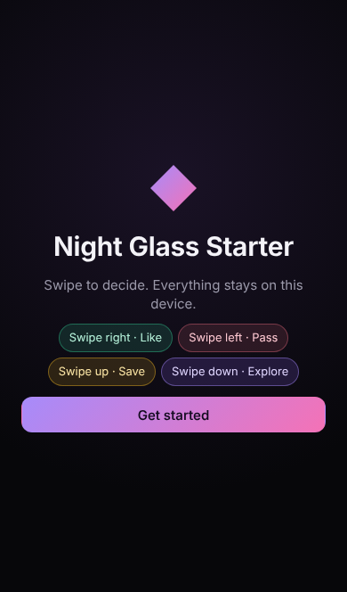
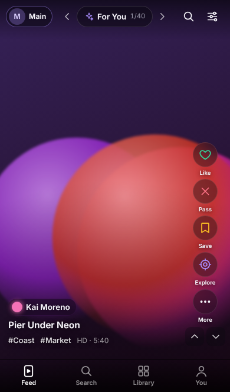
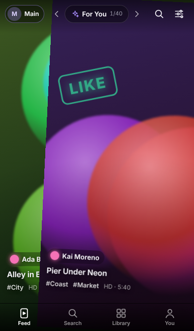
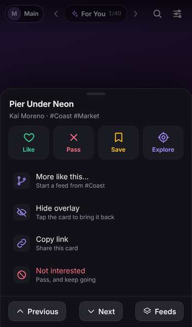
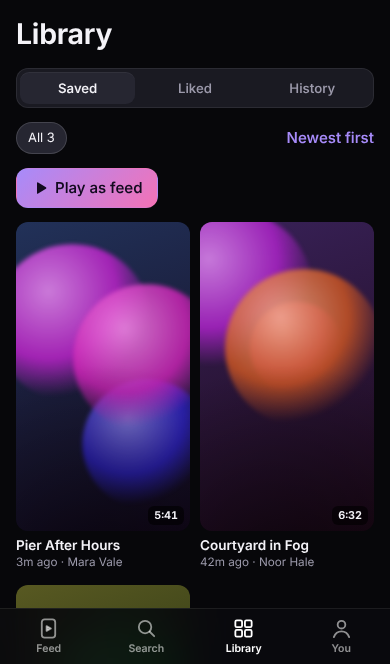

# Night Glass Starter

A mobile-first PWA starter in the **Night Glass** interface:
- a full-bleed swipe feed with a glass action rail
- a frosted top bar and tab bar
- bottom sheets you can drag to dismiss
- toasts with Undo
- four tabs, seeded mock data, and visual checks that keep the look from drifting

| Welcome | Feed | Dragging | Action sheet | Library |
|---|---|---|---|---|
|  |  |  |  |  |

## Start a new app from it

```bash
# From a copy of this folder:
npx degit asheynov124-pixel/atlas/night-glass-starter#claude/vibrant-maxwell-ar8ssc my-app
# (for a private repo: clone it and copy night-glass-starter/ instead)
cd my-app
npm install
npm run dev
```

Then make it yours. The design stays; these files change:

1. **`src/app/config.ts`:** the app's name, tagline and feed name.
2. **`src/app/verbs.ts`:** what the four actions mean in your app. This is the one
   decision that shapes every screen. For a recipe app: Cook, Skip, Save, Remix. Keep the
   keys; they pick the colors.
3. **`src/data/`:** your content. Change `Card` in `types.ts`, replace `mock.ts`, and
   keep the `source` interface in `source.ts` so the screens don't change.
4. **`src/ui/Art.tsx`:** swap the procedural stand-in for your images or video. Keep
   `data-media` on the media element.
5. **`vite.config.ts` and `index.html`:** the PWA name and the icon (`public/icon.svg`).

## The visual check has two parts

| | Screenshot baselines | Design lint |
|---|---|---|
| **Catches** | Any pixel change to a known screen | Off-system styling on any screen, including new ones |
| **How** | `toHaveScreenshot` for every screen in `tests/support/screens.ts`, at phone (390×844), small phone (375×667) and tablet (1180×820) | Reads every visible element's computed style and checks it against the rules |
| **Fails when** | A screen changed and nobody approved it | A color isn't in `tokens.css`; a radius or font weight is off the scale; a control is under 32px or has no name; a verb color is used outside its verb; there's more than one gradient button; the page scrolls sideways |
| **Fix by** | Reviewing the diff, then `npm run visual:update` if it's intended | Fixing the screen |

The lint gets its colors from `src/styles/tokens.css`, so the tokens file is the
design's source of truth. A self-test plants six kinds of violation and checks that
each is caught.

`npm run visual:sheet` writes `test-results/contact-sheet.html`. It shows the frozen
reference screens in `design/reference/` next to your app's current screens, with
expected / actual / diff for anything that drifted.

**Stable screenshots.** Tests render with a bundled copy of Inter, a frozen clock, seeded
data, no animations and no emoji in the chrome. Baselines therefore don't depend on the
fonts a machine has installed. If CI on a different machine reports tiny differences on
every screen, regenerate the baselines once inside the CI image with
`npm run visual:update:docker`.

## Scripts

| | |
|---|---|
| `npm run dev` | Dev server |
| `npm run check` | Typecheck, unit tests, build, then all Playwright tests. Run before every commit. |
| `npm test` | Unit tests: gesture classifier, verbs and Undo, feeds, search, mock determinism |
| `npm run e2e` | Behaviour: every swipe, Undo, long-press sheet and drag-to-close, double-tap, tap to hide, keyboard, reload, classic mode, reset |
| `npm run visual` | Screenshot baselines and the design lint |
| `npm run visual:update` | Accept screenshot changes, after reviewing them |
| `npm run visual:sheet` | Build the contact sheet |

CI (`.github/workflows/ci.yml`) runs `typecheck`, the unit tests and every Playwright
test in the official Playwright image. It uploads the report and contact sheet as an
artifact. GitHub only picks it up once this folder is its own repository.

## Gestures

| Where | Gesture | Meaning |
|---|---|---|
| Middle of the card | → ← ↑ ↓ | Like · Pass · Save · Explore (your four verbs) |
| From the edge, or with two fingers | ↑ ↓ / ← → | Next or previous card / switch feed |
| Anywhere | double-tap · long-press · tap | Like in place · action sheet · hide the overlay |
| Keyboard | → ← S E · ↑ ↓ · Space | The verbs · move · hide the overlay |

The classifier (`src/feed/classify.ts`) is pure and unit-tested. Its thresholds:
- the axis locks after 10px
- a swipe commits at 30% of the width or 18% of the height, or on a flick over 0.55 px/ms

## Building on it with Codex

`AGENTS.md` holds the design rules and the review gate, and Codex reads it on every
run. A first prompt can be this short:

```text
This repo is the Night Glass starter. Read AGENTS.md first and follow it exactly.

Turn it into: [WHAT THE APP IS, in one or two sentences].
- A card shows: [WHAT ONE CARD SHOWS].
- The four verbs in src/app/verbs.ts: like = [..], pass = [..], save = [..], capture = [..].
- Tabs stay Feed · Search · Library · You (rename labels only if needed).
- Keep the mock data layer: reshape Card and mock.ts for this content, and keep `source`.

Work in small commits. Before each one, run `npm run check`.
- If a screenshot fails because a screen intentionally changed, review the diff, run
  `npm run visual:update`, and name the screens that changed in the commit message.
- Never loosen tests/support/lint.ts to get a pass.
- Add every new screen to tests/support/screens.ts.
```

## Project layout

```
src/
  app/        config.ts (names) · verbs.ts (the verb mapping)
  data/       types.ts · mock.ts (seeded) · source.ts (the one data interface)
  feed/       classify.ts (+ test) · useStageGestures.ts · FeedView · FeedCard · TopBar · actions.ts · feeds.ts
  state/      store.ts (persisted, + test) · ui.ts (session)
  styles/     tokens.css (every color) · app.css (components)
  ui/         Sheet · SheetHost · Toasts · TabBar · Welcome · Art · Tile · Icons · common
  views/      SearchView · LibraryView · YouView
tests/
  e2e/        flows.spec.ts
  visual/     screens.spec.ts · design-lint.spec.ts · __screens__/ (baselines)
  support/    app.ts (helpers) · screens.ts (the screen list) · lint.ts (the rules)
design/reference/   the frozen Night Glass screens
scripts/contact-sheet.mjs
```
